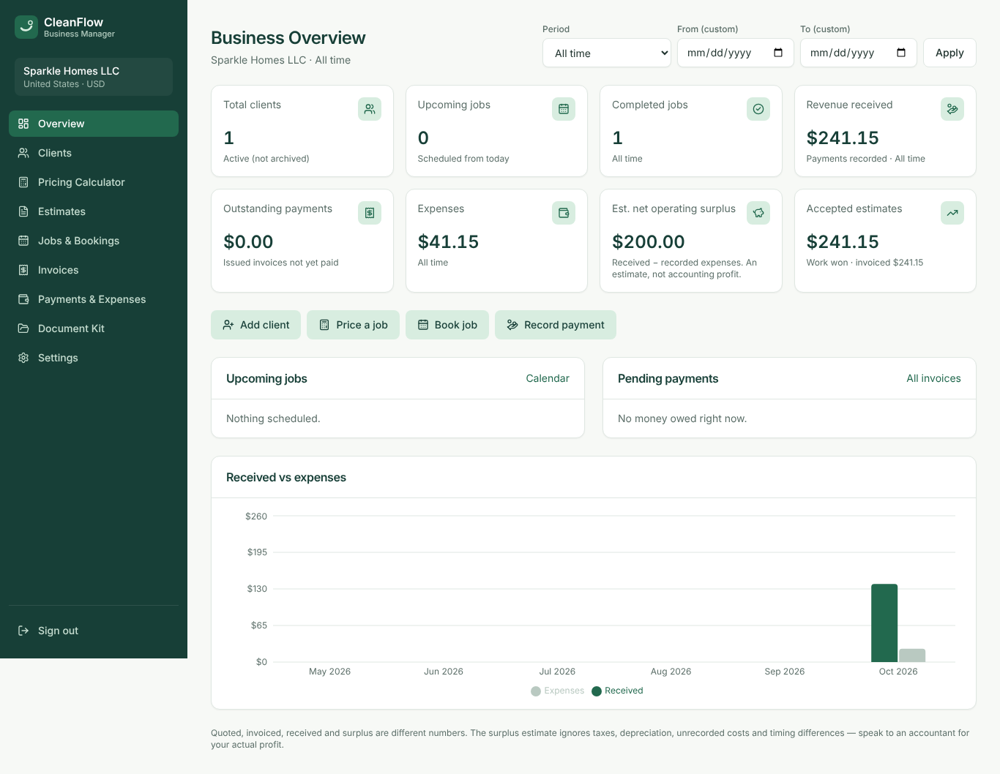

# CleanFlow Business Manager

**Manage your cleaning business without complicated software.**

CleanFlow is a web application for self-employed house cleaners and small residential cleaning teams in the **United States** and the **United Kingdom**. It keeps clients, pricing, estimates/quotes, bookings, job checklists, invoices, payments, expenses and a professional document kit in one place.



## What it does

| Module | Highlights |
| --- | --- |
| **Business Overview** | Total clients, upcoming/completed jobs, revenue received, outstanding payments, expenses, estimated net operating surplus, accepted quote value, upcoming jobs, pending payments, received-vs-expenses chart, period filters (month, 30 days, quarter, YTD, 12 months, all time, custom). |
| **Clients** | Add, edit, search, filter, archive/restore, permanent erasure; contact details, service address, preferences, notes; full history of quotes, jobs, invoices and payments. |
| **Smart Pricing Calculator** | `Total Costs = Labour + Supplies + Travel + Other` and `Suggested Price = Total Costs / (1 − Target Gross Margin)`; live breakdown, gross contribution, actual margin, manual price override, warnings for omitted costs or below-cost prices; saves a draft quote linked to the client (recalculated on the server). |
| **Quotes & Estimates** | Per-business numbering (`EST-0001` / `QUO-0001`), line items, validity date, notes, version history on every save, statuses Draft → Sent → Accepted / Declined, US Letter / A4 PDF, one-click conversion of an accepted quote into a booked job. |
| **Jobs & Bookings** | List and month calendar views (agenda on phones), statuses Scheduled / In Progress / Completed / Cancelled, duration, price, execution notes, a checklist per job with saved progress, printable checklist and booking confirmation. |
| **Payments & Expenses** | Invoices from completed jobs (one per job) or manual invoices, derived payment status Unpaid / Partially Paid / Paid / Overdue, manual payment recording (no card processing), overpayment and currency checks, expenses by category, CSV export, operational cash-flow chart. |
| **Document Kit** | 12 templates (11 shown per market): Client Intake Form, Cleaning Estimate/Quote, Service Invoice, Booking Confirmation, Standard / Deep / Move-In-Move-Out (US) / End of Tenancy (UK) checklists, Client Welcome Guide, Service Scope Worksheet, Follow-Up Messages, Review Request Messages. Fill with a client or job, edit the wording (saved per business, with placeholders), preview, print, export PDF. |
| **Settings** | Business details, logo, market, currency (controlled change, never converts history), date format, time zone, pricing defaults, number prefixes, payment terms, invoice footer. |
| **Onboarding** | Welcome → Market → Business details → Pricing defaults → First client → First quote, with optional demo data. |
| **Data & privacy** | Full JSON export, per-module CSV export, demo data load/remove, account deletion. |
| **Licensing (prepared)** | Licence table, activation by verified email, refund/revoke, an optional licence gate and a webhook endpoint ready for a checkout provider. **No payment system is simulated.** |

### US vs UK localisation

| | United States | United Kingdom |
| --- | --- | --- |
| Currency | USD ($) | GBP (£) |
| Language | American English (Labor, Canceled, Check, ZIP code, State) | British English (Labour, Cancelled, Cheque, Postcode, County) |
| Dates | MM/DD/YYYY, 12-hour times | DD/MM/YYYY, 24-hour times, weeks start Monday |
| Paper | US Letter | A4 |
| Sales document | Estimate | Quote |
| Vacant-property clean | Move-In / Move-Out Cleaning | End of Tenancy Cleaning |

Dates are stored as ISO calendar dates, times as wall-clock times in the business time zone, and money as `numeric(12,2)` with integer-cent arithmetic in the app. Formatting uses `Intl` at the edges only.

## Tech stack

- **Next.js 16** (App Router, Server Components, Server Actions, `proxy.ts`), **React 19**, **TypeScript 5.9**
- **Tailwind CSS 4** with shadcn/ui-style components (Radix primitives, `class-variance-authority`)
- **Supabase** (PostgreSQL 17, Auth, PostgREST) with Row Level Security
- **Zod 4** + **React Hook Form** (same schemas in the browser and in server actions)
- **@react-pdf/renderer** for PDFs, **Recharts** for charts, **sonner** for toasts
- **Vitest** (unit + database integration), **Playwright** + **axe-core** (end-to-end, accessibility)

## Quick start (local)

Requirements: Node.js ≥ 20.9 (tested on 22), **npm 11** (`npx npm@11 install` works if you have npm 10, which has a peer-dependency bug with Vitest 4), Docker.

```bash
cd cleanflow
npx npm@11 install
```

```bash
cp .env.example .env.local
```

```bash
npm run db:start
```

`db:start` launches a minimal local Supabase stack (Postgres, Auth, REST, mail catcher) and applies the migrations in `supabase/migrations`. It prints the API URL, the publishable/anon key and the service-role key. Put them in `.env.local`:

```
NEXT_PUBLIC_SUPABASE_URL=http://127.0.0.1:54321
NEXT_PUBLIC_SUPABASE_PUBLISHABLE_KEY=<anon / publishable key>
SUPABASE_SERVICE_ROLE_KEY=<service role key>   # only for scripts and tests
```

```bash
npm run dev
```

Open http://localhost:3000, create an account and follow the onboarding. Local email confirmation is off; sign-up emails (password reset etc.) are captured by Mailpit at http://127.0.0.1:54324.

Optional — a ready-made demo account with fictional data:

```bash
npm run seed:demo -- US
```

> If Docker cannot pull from `public.ecr.aws` in your network, prefix Supabase commands with `SUPABASE_INTERNAL_IMAGE_REGISTRY=docker.io`.

## Scripts

| Command | Purpose |
| --- | --- |
| `npm run dev` / `build` / `start` | Develop, build, run in production mode |
| `npm run typecheck` / `lint` | TypeScript and ESLint |
| `npm test` | Unit tests (pricing, money, dates, finance, CSV, documents, localisation, validation) |
| `npm run test:integration` | Database tests against local Supabase: RLS isolation, integrity triggers, full flow, demo separation, licences, account deletion |
| `npm run test:e2e` | Playwright end-to-end tests against a running app (`http://localhost:3000`, override with `E2E_BASE_URL`) |
| `npm run db:start` / `db:stop` / `db:reset` | Local Supabase lifecycle (`db:reset` re-applies all migrations) |
| `npm run db:types` | Regenerate `src/lib/supabase/database.types.ts` from the local schema |
| `npm run seed:demo -- US\|UK` | Create a local demo account with demo data |
| `npm run license -- grant\|revoke\|refund\|status <email>` | Manual licence administration (service-role key required) |

## Project structure

```
cleanflow/
├── supabase/
│   ├── config.toml                 Local Supabase configuration
│   └── migrations/                 Versioned SQL: schema, integrity triggers, RLS & grants, business functions
├── src/
│   ├── proxy.ts                    Session refresh + route protection (Next 16 "proxy", formerly middleware)
│   ├── app/
│   │   ├── (auth)/                 Login, sign-up, password reset
│   │   ├── (app)/                  Authenticated app: dashboard, clients, pricing, quotes, jobs, invoices, payments, documents, settings
│   │   ├── onboarding/             6-step setup wizard
│   │   ├── license/                Licence gate (only when CLEANFLOW_REQUIRE_LICENSE=true)
│   │   └── api/                    PDF, CSV/JSON export, licensing webhook
│   ├── components/                 UI primitives (ui/), layout, shared widgets
│   └── lib/                        Domain logic (pricing, finance, money, dates, market), validation, documents, PDFs, Supabase clients
├── scripts/                        license-admin.mjs, seed-demo-account.ts
├── tests/                          unit/, integration/, e2e/, support/
└── docs/                           Architecture, deployment, licensing, privacy, test report, limitations, screenshots, sample PDFs
```

## Documentation

- [Architecture & security model](docs/ARCHITECTURE.md)
- [Deployment guide](docs/DEPLOYMENT.md)
- [Licensing & commercial delivery](docs/LICENSING.md)
- [Privacy & compliance notes (US/UK)](docs/PRIVACY_AND_COMPLIANCE.md)
- [Test report](docs/TEST_REPORT.md)
- [Limitations & pending work](docs/LIMITATIONS.md)
- [Screenshots](docs/screenshots) and [sample PDFs](docs/sample-pdfs)

## Important notices

- **Not accounting or tax software.** “Estimated net operating surplus” is payments received minus recorded expenses. It is not net profit. No sales tax or VAT is calculated.
- **Templates are not legal documents.** The document kit is not a legally validated contract, tax invoice, insurance or safety certificate. State, local and UK requirements must be reviewed before selling or relying on it.
- **No card processing.** Payments are recorded manually. No checkout or payment provider is integrated.
